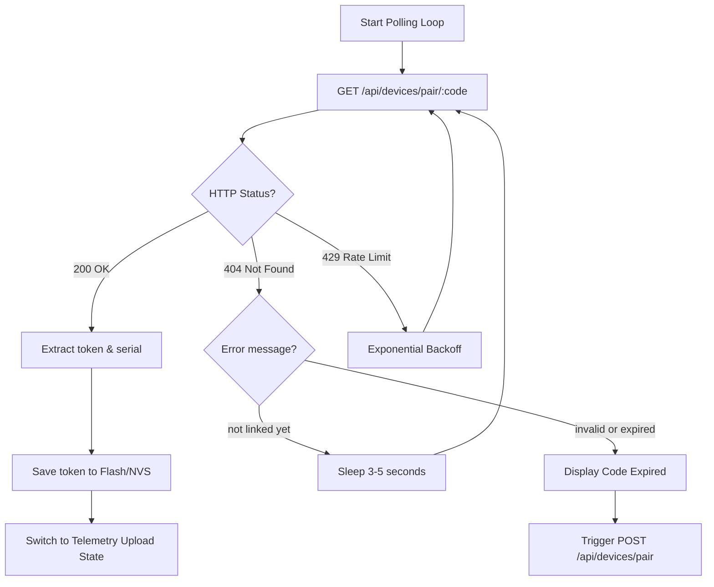

import { Tabs, TabItem } from '@astrojs/starlight/components';

After obtaining a 6-character pairing code and presenting it to the user, the hardware device periodically queries `GET /api/devices/pair/:code`. 

Once the user approves and binds the pairing code to their account via the Ayphr web console or companion app, this endpoint delivers the permanent **Device Token**.

---

## HTTP Request

```http
GET /api/devices/pair/:code HTTP/1.1
Host: api.ayphr.com
Accept: application/json
```

### Path Parameters

| Parameter | Type | Required | Description |
| :--- | :--- | :--- | :--- |
| `code` | `string` | **Yes** | The 6-character alphanumeric pairing code received in Step 1 (case-insensitive). |

### Authentication
**None**. Accessible publicly using the valid pairing code.

### Rate Limiting
- **20 requests per 15 minutes** per IP and per code.
- **Recommended Polling Interval**: Once every 3 to 5 seconds.

---

## Response Statuses

### `200 OK` (User has Linked the Device)

Returned when the user has entered the pairing code and successfully claimed the hardware device.

```json
{
  "token": "10deb076c8fd609f26499f56e66dca05c9d39e5b544c5f80f8c5c0d23938e914",
  "serial": 12345678
}
```

#### Response Properties:
- `token` (`string`): A 64-character hexadecimal device secret token (256-bit entropy).
- `serial` (`number`): The hardware serial number confirmed by the server.

:::caution[Flash Storage Requirement]
Upon receiving status `200 OK`, the microcontroller **must immediately commit this token to non-volatile memory (NVS / EEPROM)**. Once fetched, the pairing session is concluded and subsequent calls for this code will return `404 Not Found`.
:::

---

### `404 Not Found` (Awaiting User Action)

Returned while the pairing code is still valid but the user has not yet entered it into their dashboard.

```json
{
  "error": "not linked yet"
}
```

The device should sleep for 3–5 seconds and retry.

---

### `404 Not Found` (Expired or Invalid)

Returned if the code has passed its 15-minute expiration time, has already been claimed and fetched, or does not exist.

```json
{
  "error": "invalid or expired code"
}
```

The device should notify the user (e.g. "Code Expired") and initiate a fresh `POST /api/devices/pair` handshake.

---

## Polling Strategy Flowchart



---

## Implementation Examples

<Tabs>
  <TabItem label="cURL">
    ```bash
    curl -X GET https://api.ayphr.com/api/devices/pair/737ER4 \
      -H "Accept: application/json"
    ```
  </TabItem>
  <TabItem label="Python Polling Loop">
    ```python
    import time
    import requests

    code = "737ER4"
    url = f"https://api.ayphr.com/api/devices/pair/{code}"

    while True:
        resp = requests.get(url)
        if resp.status_code == 200:
            data = resp.json()
            device_token = data["token"]
            print(f"Device paired! Token: {device_token}")
            # Save token to persistent storage
            break
        elif resp.status_code == 404:
            err = resp.json().get("error")
            if err == "not linked yet":
                print("Waiting for user to claim code...")
                time.sleep(3)
            else:
                print("Code expired or invalid. Restarting pairing.")
                break
        elif resp.status_code == 429:
            time.sleep(5)
    ```
  </TabItem>
  <TabItem label="JavaScript">
    ```javascript
    async function pollForToken(code) {
      while (true) {
        const res = await fetch(`https://api.ayphr.com/api/devices/pair/${code}`);
        if (res.status === 200) {
          const { token } = await res.json();
          localStorage.setItem('ayphr_device_token', token);
          return token;
        }
        if (res.status === 404) {
          const { error } = await res.json();
          if (error === 'not linked yet') {
            await new Promise((r) => setTimeout(r, 3000));
            continue;
          }
          throw new Error('Pairing code expired or invalid');
        }
        await new Promise((r) => setTimeout(r, 5000));
      }
    }
    ```
  </TabItem>
</Tabs>

