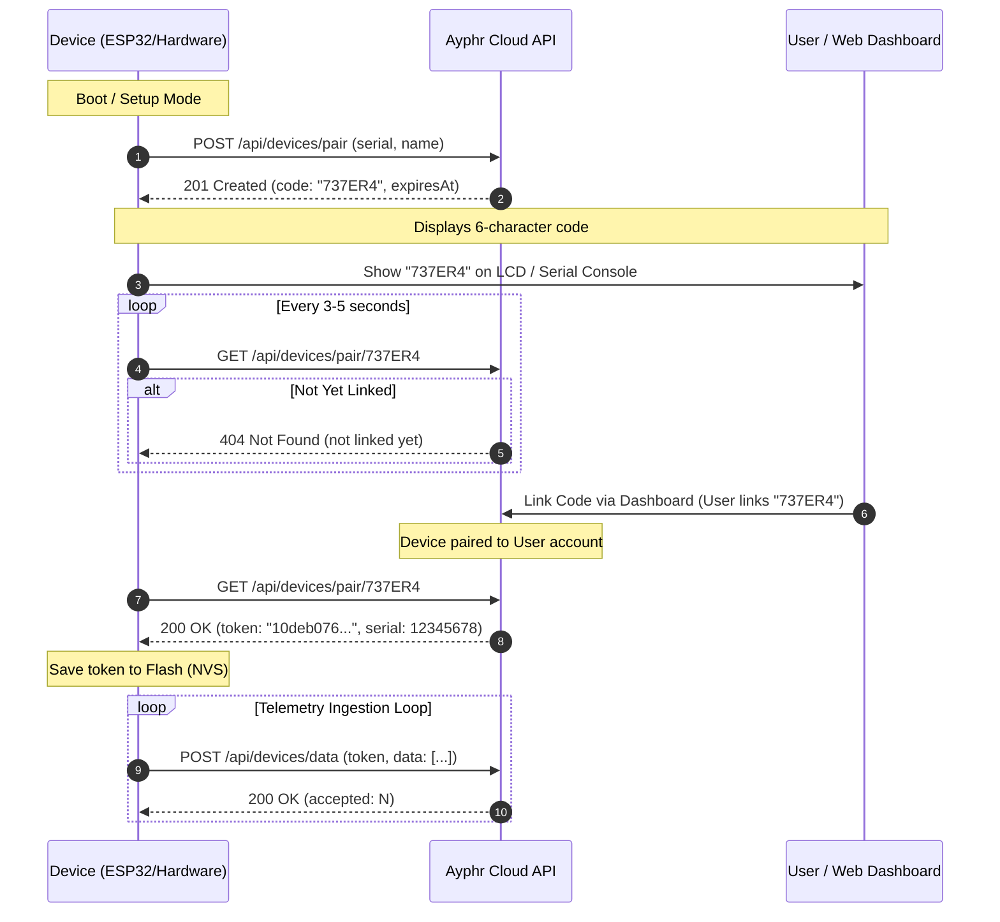

import { Tabs, TabItem } from '@astrojs/starlight/components';

The Ayphr Public Device API provides a zero-friction, hardware-friendly integration protocol for microcontrollers (such as ESP32, STM32, Raspberry Pi Pico), IoT gateways, and environmental logging stations.

---

## Security Model: Device Tokens vs. Account Tokens

Embedded devices deployed in the field—whether in home environments, agricultural installations, or remote weather stations—must never store user account passwords, session cookies, or long-lived personal user API keys in their onboard flash memory:

1. **Physical Flash Vulnerability**: An attacker with physical access to hardware can dump flash/EEPROM over SPI or JTAG.
2. **Constrained Hardware Resources**: Microcontrollers lack browser environments and complex OAuth token refresh cycles.
3. **Dedicated Scope**: A device token only has permission to ingest telemetry data for that single physical device (`serial`). It has no access to user profile data, billing, other devices, or administrative controls.

Instead, Ayphr uses an **ephemeral pairing code exchange** to provision a dedicated 64-character hexadecimal **Device Token** that is cryptographically hashed with SHA-256 on our servers.

---

## End-to-End Pairing Flow



---

## Protocol Lifecycle Steps

1. **Step 1: Request Pairing Code (`POST /api/devices/pair`)**  
   The unlinked hardware device connects to Wi-Fi/Ethernet and sends its unsigned 32-bit hardware serial number to request a pairing code. The server returns a 6-character uppercase alphanumeric code (e.g. `737ER4`) valid for 15 minutes.

2. **Step 2: User Claims Code**  
   The device displays this code on its screen, companion Bluetooth interface, or serial monitor. The user types this code into the Ayphr web console or companion app.

3. **Step 3: Retrieve Device Token (`GET /api/devices/pair/:code`)**  
   While awaiting the user, the device periodically polls this endpoint (every 3–5 seconds). As soon as the user claims the code, the server returns the permanent 64-character hexadecimal device token. The device saves this token to non-volatile storage (NVS / EEPROM).

4. **Step 4: Continuous Telemetry Ingestion (`POST /api/devices/data`)**  
   The device uploads batches of time-series sensor points using its device token in the JSON body. No headers or session tokens are required.

---

## API Base URLs

| Environment | Base URL |
| :--- | :--- |
| **Production** | `https://api.ayphr.com` |
| **Local Development** | `http://localhost:3000` |

---

## Common HTTP Headers

All endpoints in the Public Device API expect:

```http
Content-Type: application/json
Accept: application/json
```

---

## Summary of Public Device Endpoints

| Endpoint | Method | Auth | Description |
| :--- | :--- | :--- | :--- |
| `/api/devices/pair` | `POST` | None (Public) | Request a new 6-character pairing code |
| `/api/devices/pair/:code` | `GET` | None (Public) | Poll and retrieve the device token once linked |
| `/api/devices/data` | `POST` | Device Token in Body | Ingest a batch of telemetry sensor data |

