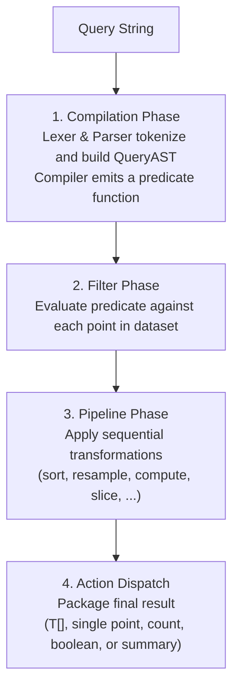

import { Card, CardGrid, LinkCard } from '@astrojs/starlight/components';

**TelemetryQL** (or **TQL**) is a lightweight, expressive, domain-specific query and transformation language engineered specifically for time-series telemetry points, embedded sensors, and environmental monitoring devices.

Traditional query languages like SQL or PromQL are often either too bulky to embed in client-side sensor dashboards or ill-suited for the realities of analog hardware signals—where physical noise, ADC quantization jitter, calibration drift, and high-frequency time intervals are everyday realities.

TQL solves this with a clean, arrow-function syntax, built-in sensor tolerance primitives, multi-stage pipelines, and memory-safe, sandboxed execution.

---

## Key Capabilities

- **Intuitive Arrow Syntax**: Write queries that read like modern functional code: `findAll( p -> { p.temperature > 20 } ) then operation()`.
- **First-Class Sensor Tolerance**: Built-in absolute (`~delta~=`) and percentage (`~delta%~=`) tolerance operators to seamlessly accommodate sensor fluctuation.
- **Nested Field Traversal**: Query complex nested telemetry objects using standard dot notation (`p.sensor.environment.tempC`).
- **Flexible Query Roots**: Select all records (`findAll`), query boundaries (`findFirst`, `findLast`), compute counts (`count`), or perform existence checks (`exists`). Every root also accepts no arguments (`findAll()`, `count()`, and so on) to operate on the entire dataset without a filter.
- **Composable Pipelines**: Chain multi-stage data processing with `then`: sorting, pagination, field projection, data imputation (`fill`, `fillPrevious`), mathematical derivations (`compute`), and bounding (`clamp`).
- **Time-Series Analytics**: Native window downsampling (`resample`), derivative rates of change (`rate`, `diff`), rolling moving averages (`movingAverage`), and statistical summaries (`summary()`).
- **Sandboxed & Secure**: Compiles into pure, deterministic closures without using `eval()` or `Function()`. Safe for browser frontends, Edge workers, and server backends.

---

## Anatomy of a Query

Every TQL query consists of two primary sections: a **Query Root & Filter Clause**, followed by optional **Pipeline Operations** chained with `then`.

```text
<action>( <variable> -> { <variable>.<field> <operator> <value> } ) [ then <operation> ]*   // filtered
<action>()                                                         [ then <operation> ]*   // unfiltered
```

The **Query Root & Filter Clause** can also omit its arguments entirely. For example, `findAll()` skips filtering and returns every record, while `count()` returns the total record count.

### Complete Example

Consider a continuous stream of climate telemetry points where you want to detect anomalous conditions—temperature exceeding target threshold, humidity within acceptable bounds, and battery level healthy—and then compute the Fahrenheit value, downsample into 5-minute averages, and take the top 10 results:

```text
findAll( point -> ( {point.tempC > point.targetTemp} & {point.relHumidity ~2%~= 50} & !{point.battery < 20} ) )
  then compute(tempF, (tempC * 1.8) + 32)
  then resample("5m", "avg", tempF)
  then sortDescending(tempF)
  then limit(10)
```

---

## Execution Lifecycle

When TQL evaluates a query string against a dataset, it progresses through four distinct phases:



1. **Compilation Phase**: The query string is tokenized by the `Lexer` and parsed into an AST by the `Parser`. The `Compiler` compiles the condition tree into a single high-performance JavaScript predicate function.
2. **Filter Phase**: Every point in the dataset is evaluated against the compiled predicate.
3. **Pipeline Phase**: The surviving points pass sequentially through each pipeline operation in order from left to right.
4. **Action Dispatch**: The root query action (`findAll`, `findFirst`, `findLast`, `count`, `exists`) packages the final return value according to its semantics.

---

## Explore the Documentation

<CardGrid grid={2}>
  <Card title="Query Roots & Selectors" icon="magnifier">
    Learn how to use `findAll`, `findFirst`, `findLast`, `count`, and `exists` to shape query outcomes.
    <LinkCard title="Read Query Roots Guide" href="/tql/queries/" />
  </Card>

  <Card title="Filter Syntax & Conditions" icon="pencil">
    Master standard comparison operators, nested property paths, and field-to-field comparisons.
    <LinkCard title="Read Filter Guide" href="/tql/filters/" />
  </Card>

  <Card title="Tolerance & Sensor Bounds" icon="puzzle">
    Dive deep into absolute and percentage tolerance operators and dynamic setpoint physics.
    <LinkCard title="Read Tolerance Guide" href="/tql/tolerance/" />
  </Card>

  <Card title="Pipeline & Analytics" icon="setting">
    Transform time-series data with resampling, moving averages, derivatives, and statistical summaries.
    <LinkCard title="Read Pipeline Guide" href="/tql/pipeline/" />
  </Card>
</CardGrid>
